# 🚌 T-GO Application Userflow

Dokumen ini menjelaskan alur pengguna (userflow) lengkap dari aplikasi T-GO, sebuah platform pemesanan tiket transportasi publik.

---

## 📑 Daftar Isi

1. [Arsitektur Aplikasi](#arsitektur-aplikasi)
2. [Userflow: Pengguna (User)](#userflow-pengguna-user)
3. [Userflow: Admin](#userflow-admin)
4. [Diagram Alur](#diagram-alur)
5. [Daftar Halaman](#daftar-halaman)

---

## 🏗️ Arsitektur Aplikasi

```
T-GO Application
├── 🌐 Public Pages (Tanpa Login)
│   ├── Landing Page (/)
│   ├── Login (/login)
│   ├── Register (/register)
│   ├── Forgot Password (/forgot-password)
│   └── Reset Password (/reset-password)
│
├── 👤 User Dashboard (/dashboard)
│   ├── Home (Beranda)
│   ├── Booking (/dashboard/booking)
│   ├── Map (/dashboard/map)
│   ├── Ticket (/dashboard/ticket)
│   ├── Payment (/dashboard/payment)
│   └── Profile (/dashboard/profile)
│       ├── Account Settings
│       ├── Security (Change Password)
│       └── Promos
│
└── 🔧 Admin Panel (/admin)
    ├── Dashboard Overview
    ├── Analytics (/admin/analytics)
    ├── Routes Management (/admin/routes)
    ├── Stops Management (/admin/stops)
    ├── Tickets Management (/admin/tickets)
    ├── Users Management (/admin/users)
    ├── Wallet Transactions (/admin/wallet)
    └── Settings (/admin/settings)
```

---

## 👤 Userflow: Pengguna (User)

### Flow 1: Registrasi & Login

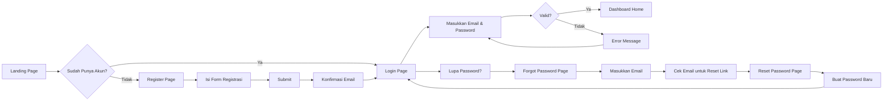

**Langkah-langkah:**

1. **Registrasi Baru**

   - Buka aplikasi → Klik "Daftar"
   - Isi nama, email, password
   - Submit → Konfirmasi email
   - Login dengan kredensial baru

2. **Login**

   - Masukkan email & password
   - Klik "Masuk"
   - Redirect ke Dashboard

3. **Lupa Password**
   - Klik "Lupa Password?" di halaman login
   - Masukkan email terdaftar
   - Cek inbox untuk link reset
   - Buat password baru

---

### Flow 2: Pemesanan Tiket (Booking)

```mermaid
flowchart LR
    A[Dashboard Home] --> B[Pilih Titik Asal & Tujuan]
    B --> C[Klik 'Cari Rute']
    C --> D[Daftar Rute Tersedia]

    D --> E[Pilih Rute]
    E --> F[Buka Booking Modal]

    F --> G[Pilih Titik Jemput]
    G --> H[Pilih Tujuan Akhir]
    H --> I[Pilih Jumlah Penumpang]
    I --> J[Pilih Tanggal Perjalanan]
    J --> K[Lihat Total Harga]

    K --> L{Saldo Cukup?}
    L -->|Ya| M[Konfirmasi Pembayaran]
    L -->|Tidak| N[Top Up Saldo]
    N --> O[Pilih Nominal]
    O --> P[Pilih Metode Pembayaran]
    P --> Q[Proses Top Up]
    Q --> L

    M --> R[Pembayaran Berhasil]
    R --> S[Generate QR Code Tiket]
    S --> T[Tiket Tersimpan]
```

**Langkah-langkah:**

1. **Cari Rute**

   - Di Dashboard, pilih "Dari" (titik asal)
   - Pilih "Ke" (titik tujuan)
   - Klik "Cari Rute"
   - Sistem menampilkan rute yang tersedia

2. **Pilih & Pesan**

   - Klik pada rute yang diinginkan
   - Modal booking terbuka
   - Pilih titik jemput spesifik
   - Pilih tujuan akhir
   - Atur jumlah penumpang
   - Pilih tanggal perjalanan

3. **Pembayaran**

   - Review total harga
   - Jika saldo cukup → Klik "Bayar"
   - Jika saldo kurang → Top up dulu
   - Setelah sukses, tiket di-generate

4. **Tiket**
   - QR Code tiket tersimpan di halaman Ticket
   - Bisa diakses kapan saja sebelum perjalanan

---

### Flow 3: Top Up Saldo

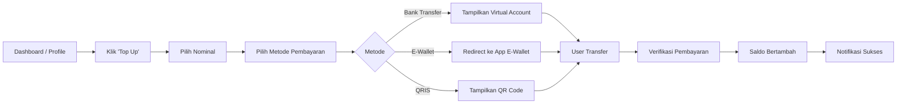

**Metode Pembayaran:**

- 🏦 Bank Transfer (BCA, Mandiri, BNI, BRI)
- 💳 E-Wallet (GoPay, OVO, DANA, ShopeePay)
- 📱 QRIS

---

### Flow 4: Penggunaan Tiket

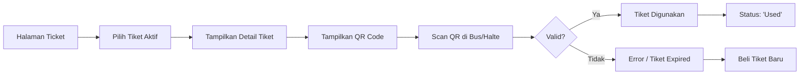

**Status Tiket:**
| Status | Deskripsi |
|--------|-----------|
| `active` | Tiket masih berlaku, bisa digunakan |
| `used` | Tiket sudah dipakai |
| `expired` | Tiket melewati tanggal perjalanan |
| `cancelled` | Tiket dibatalkan |

---

### Flow 5: Melihat Peta & Rute

```mermaid
flowchart LR
    A[Dashboard] --> B[Klik 'Map' di Navbar]
    B --> C[Halaman Peta]

    C --> D[Lihat Peta Interaktif]
    D --> E[Pilih Rute dari Daftar]
    E --> F[Highlight Rute di Peta]
    F --> G[Lihat Semua Halte/Stops]

    G --> H[Klik pada Halte]
    H --> I[Lihat Detail Halte]
    I --> J[Jadwal Bus di Halte Ini]
```

---

### Flow 6: Manajemen Profil

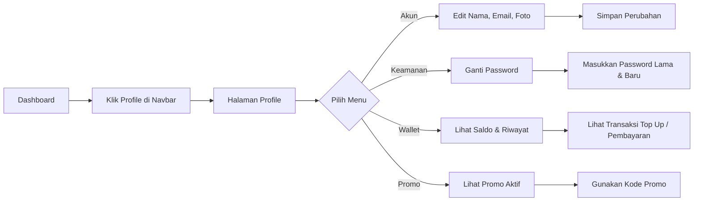

---

## 🔧 Userflow: Admin

### Flow 1: Dashboard Overview

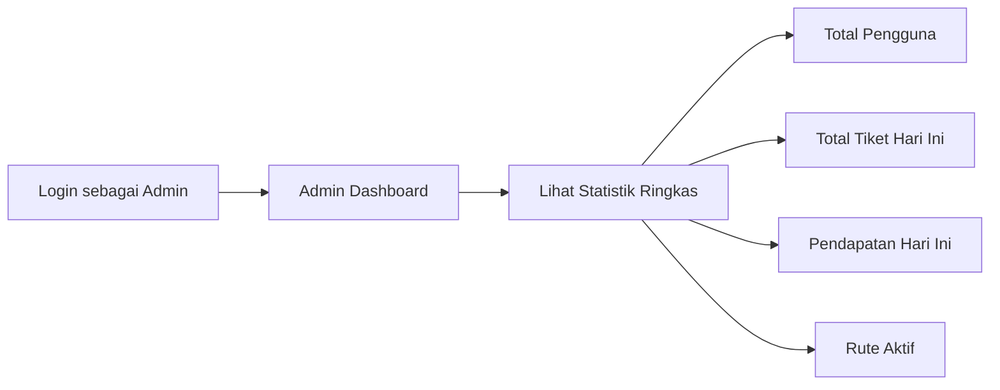

---

### Flow 2: Analytics & Reporting

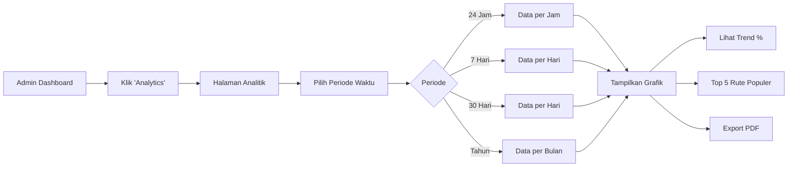

**Metrik yang Ditampilkan:**

- 💰 Total Pendapatan (dengan trend %)
- 🎫 Tiket Terjual (dengan trend %)
- 👥 Total Penumpang (dengan trend %)
- 📊 Okupansi Rata-rata

---

### Flow 3: Manajemen Rute

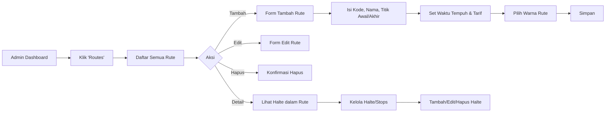

**Data Rute:**

- Kode Rute (R01, R02, dst)
- Nama Rute
- Titik Awal & Akhir
- Estimasi Waktu (menit)
- Tarif (Rupiah)
- Warna (untuk peta)

---

### Flow 4: Manajemen Pengguna

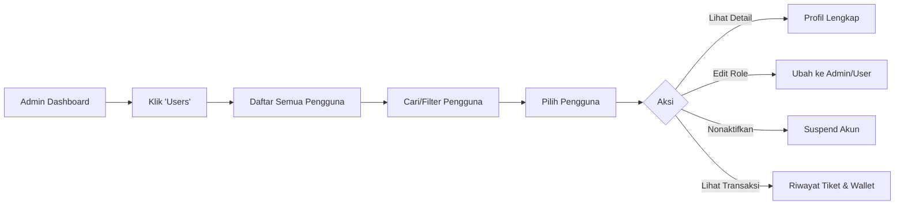

---

### Flow 5: Manajemen Wallet & Transaksi

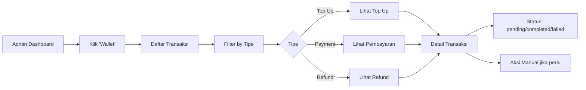

---

## 📊 Diagram Alur Lengkap

### User Journey Map

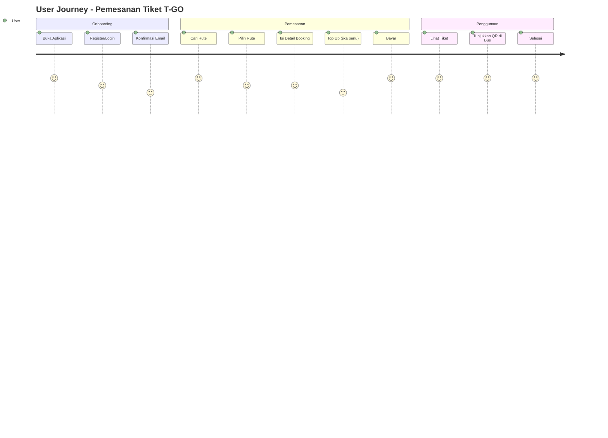

---

## 📄 Daftar Halaman

### Public Pages

| Path               | Nama            | Deskripsi                  |
| ------------------ | --------------- | -------------------------- |
| `/`                | Landing Page    | Halaman utama aplikasi     |
| `/login`           | Login           | Form login pengguna        |
| `/register`        | Register        | Form pendaftaran akun baru |
| `/forgot-password` | Forgot Password | Request reset password     |
| `/reset-password`  | Reset Password  | Form buat password baru    |

### User Dashboard

| Path                          | Nama     | Deskripsi                    |
| ----------------------------- | -------- | ---------------------------- |
| `/dashboard`                  | Home     | Beranda dashboard, cari rute |
| `/dashboard/booking`          | Booking  | Detail pemesanan             |
| `/dashboard/map`              | Map      | Peta interaktif rute         |
| `/dashboard/ticket`           | Ticket   | Daftar tiket user            |
| `/dashboard/payment`          | Payment  | Proses pembayaran            |
| `/dashboard/profile`          | Profile  | Halaman profil & wallet      |
| `/dashboard/profile/account`  | Account  | Edit data akun               |
| `/dashboard/profile/security` | Security | Ganti password               |
| `/dashboard/profile/promos`   | Promos   | Daftar promo aktif           |

### Admin Panel

| Path               | Nama      | Deskripsi          |
| ------------------ | --------- | ------------------ |
| `/admin`           | Dashboard | Overview statistik |
| `/admin/analytics` | Analytics | Grafik & laporan   |
| `/admin/routes`    | Routes    | Kelola rute        |
| `/admin/stops`     | Stops     | Kelola halte       |
| `/admin/tickets`   | Tickets   | Daftar semua tiket |
| `/admin/users`     | Users     | Kelola pengguna    |
| `/admin/wallet`    | Wallet    | Transaksi wallet   |
| `/admin/settings`  | Settings  | Pengaturan sistem  |

---

## 🔐 Autentikasi & Otorisasi

```mermaid
flowchart LR
    A[Request] --> B{Authenticated?}
    B -->|No| C[Redirect ke Login]
    B -->|Yes| D{Role?}

    D -->|User| E[Akses Dashboard User]
    D -->|Admin| F[Akses Dashboard User + Admin]

    E --> G[/dashboard/*]
    F --> G
    F --> H[/admin/*]

    C --> I[Login Page]
    I --> J[Submit Credentials]
    J --> K{Valid?}
    K -->|Yes| L[Set Session]
    K -->|No| M[Error]

    L --> D
```

---

## 📱 Responsive Design

Aplikasi T-GO didesain responsif untuk:

- 📱 Mobile (< 768px)
- 📋 Tablet (768px - 1024px)
- 💻 Desktop (> 1024px)

**Navigasi:**

- Mobile: Bottom Navigation Bar
- Desktop: Sidebar

---

_Dokumen ini dibuat pada 4 Januari 2026_
